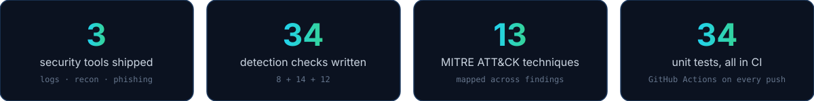



 

 

  
  
  

---

### 👋 About me

I'm a final-year **B.Tech CSE (Cyber Security)** student at **SRM Institute of Science and Technology**, graduating in May 2027.
During my **VAPT internship at Dhara Global Solutions** I tested enterprise networks with Nmap, Nessus, Burp Suite and Metasploit and wrote the reports that explained each finding.

Now I build the other side: small, tested Python tools that **detect** the attacks I learned to run. Each one maps its findings to MITRE ATT&CK, ships with unit tests, and runs in CI.

  

---

### 🛡️ Security tooling

<table>
  <tr>
    <td width="50%" valign="top">
      <h3>📧 <a href="https://github.com/chaitanyasai9666/phishing-email-analyzer">Phishing Email Analyzer</a></h3>
      

        
        
        
      

      
<b>Triage a reported email in one command.</b> Give it a saved <code>.eml</code> and it answers the four questions an analyst asks: who really sent it, where the links really go, what is attached, and whether it is pressuring the reader.

      <ul>
        <li>Checks SPF/DKIM/DMARC failures, brand impersonation, mismatched link text, raw-IP and look-alike links, and disguised attachments.</li>
        <li>Outputs a verdict plus <b>defanged URLs and SHA-256 hashes</b> ready to paste into a ticket.</li>
      </ul>
      
<code>Python</code> <code>email</code> <code>IOC extraction</code> <code>T1566</code>

    </td>
    <td width="50%" valign="top">
      <h3>📜 <a href="https://github.com/chaitanyasai9666/log-threat-analyzer">Log Threat Analyzer</a></h3>
      

        
        
        
      

      
<b>A mini SIEM rule engine for SSH and web logs.</b> It finds brute force, password spraying, a successful login after brute force, SQL injection, path traversal and directory scans.

      <ul>
        <li><b>Time-window burst detection</b> separates an attack from a forgetful user.</li>
        <li>Decodes URLs before matching, and resists <b>log injection</b> through attacker-controlled usernames.</li>
      </ul>
      
<code>Python</code> <code>regex</code> <code>detection rules</code> <code>T1110</code> <code>T1190</code>

    </td>
  </tr>
  <tr>
    <td width="50%" valign="top">
      <h3>🔎 <a href="https://github.com/chaitanyasai9666/nmap-recon-reporter">Nmap Recon Reporter</a></h3>
      

        
        
        
      

      
<b>From raw scan to a report someone can act on.</b> Runs an Nmap service scan (or reads a saved one) and writes a severity-ranked risk report with a plain-language reason and a fix for every finding.

      <ul>
        <li>Rules match the <b>detected service, not the port</b>, so telnet on port 2323 is still caught.</li>
        <li>Blocks <b>command injection</b> with allow-list target validation and shell-free execution.</li>
      </ul>
      
<code>Python</code> <code>Nmap</code> <code>XML</code> <code>T1046</code>

    </td>
    <td width="50%" valign="top">
      <h3>🏥 <a href="https://github.com/chaitanyasai9666/vle-9">Secure DevSecOps for a Healthcare App</a></h3>
      

        
        
        
      

      
<b>Security gates in a delivery pipeline.</b> A patient-records API taken through Jenkins, Docker and Kubernetes on AWS EC2 with scanning at every stage.

      <ul>
        <li>Static analysis, container image scanning and dynamic scanning before deploy.</li>
        <li>Prometheus and Grafana for monitoring and alerting on the running app.</li>
      </ul>
      
<code>Jenkins</code> <code>Docker</code> <code>Kubernetes</code> <code>Trivy</code> <code>OWASP ZAP</code>

    </td>
  </tr>
</table>

---

### ⚙️ Cloud & DevOps

| Project | What it does | Stack |
|---|---|---|
| [Devops-project](https://github.com/chaitanyasai9666/Devops-project) | A Spring Boot NLP API deployed automatically on every push, scanned by Trivy and monitored with Prometheus, Grafana and Alertmanager | Jenkins · Docker · k3s · Terraform · Ansible · AWS EC2 |
| [vle-8](https://github.com/chaitanyasai9666/vle-8) | Blue-green deployment with traffic switch and rollback through a Kubernetes Service selector | Terraform · Ansible · Docker · Minikube · Jenkins |
| [calorie-tracker](https://github.com/chaitanyasai9666/calorie-tracker) | Plate Count, a calorie and fiber tracker with tests and a CI deploy to GitHub Pages | HTML · JavaScript · GitHub Actions |

---

### 🧰 Toolbox

**Security**

  
  
  
  
  
  
  

**Languages & platforms**

  
  
  
  
  
  
  
  
  

---

  Everything here is tested on synthetic data or systems I own. Scan only what you are authorised to scan.

