

  

 

I'm a final-year **B.Tech CSE (Cyber Security)** student at **SRM Institute of Science and Technology**. As a **VAPT intern at Dhara Global Solutions** I spent a summer attacking enterprise networks with Nmap, Nessus, Burp Suite and Metasploit, and writing the reports that explained each finding.

That taught me what attacks look like from the inside. Now I write the tools that spot them: small, tested Python programs where every finding carries its MITRE ATT&CK ID.

 

## 🎯 What my tools can detect

 

## 🚀 Flagship: mini-siem

**[mini-siem](https://github.com/chaitanyasai9666/mini-siem)** is a SIEM I built from scratch in Python, with no third-party packages. Agents ship logs from monitored machines, a rule engine analyses every event as it arrives, and alerts land on this live dashboard. It comes with a Docker attack lab: an attacker container runs Nmap, Hydra and web attacks against a weak server on an isolated network, and all 11 detection rules fire within seconds.

 

## 🛠️ What else I've built

Real output from each tool. Click a card to open the repo.

  
  

  
  

  
  

  
  
  
  
  

**Also on my GitHub**

- [**Devops-project**](https://github.com/chaitanyasai9666/Devops-project) — a Spring Boot NLP API that deploys itself on every push: Jenkins, Docker, k3s, Terraform and Ansible on AWS EC2, with Trivy scans and Prometheus/Grafana monitoring.
- [**vle-8**](https://github.com/chaitanyasai9666/vle-8) — blue-green deployment with instant traffic switch and rollback on Kubernetes.
- [**calorie-tracker**](https://github.com/chaitanyasai9666/calorie-tracker) — Plate Count, a calorie and fiber tracker with tests and a CI deploy to GitHub Pages.

 

## 🧭 How I got here

 

## 🧰 Toolbox

 

## 📫 Say hello

Graduating **May 2027** and open to SOC analyst, VAPT and security engineering roles.
Find me on **[LinkedIn](https://www.linkedin.com/in/chaitanya-sai-63b216350/)**.

  Everything here is tested on synthetic data or systems I own. Scan only what you are authorised to scan.

